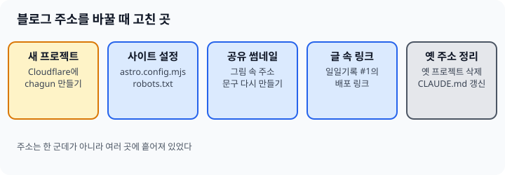

블로그 주소를 `step-by-code-7dd.pages.dev`에서 **`chagun.pages.dev`** 로 바꿨다. 주소만 바꾸면 끝일 줄 알았는데, 주소가 적힌 곳이 여러 군데라서 하나씩 찾아 고쳐야 했다.

## 왜 바꿨나

처음 배포할 때 원하는 이름(`step-by-code`)이 이미 누가 쓰고 있어서, 뒤에 `-7dd`라는 임의의 글자가 붙은 주소가 됐다. 이 이야기는 첫 글들에도 적어 뒀다. 이름이 길고 뒤에 의미 없는 글자가 붙은 채로 계속 쓰기엔 아쉬워서 새 주소로 옮기기로 했다.

## 어떻게 바꿨나

Cloudflare Pages는 **프로젝트 이름이 곧 주소**다. 그래서 주소를 바꾸려면 이름이 `chagun`인 **새 프로젝트**를 만들어서 GitHub 저장소를 다시 연결해야 했다. 새 주소에서 블로그가 정상으로 뜨는 걸 확인한 뒤에 옛 프로젝트는 삭제했다.

## 주소가 적혀 있던 곳

1. **사이트 설정**: `astro.config.mjs`의 `site` 값이다. 사이트맵, RSS, 공유 미리보기 태그가 모두 이 값을 바탕으로 주소를 만든다. `public/robots.txt`에도 사이트맵 주소가 적혀 있어서 같이 바꿨다.
2. **공유 썸네일**: 카톡 미리보기에 뜨는 그림(`og-default.png`) 안에 주소 문구가 들어 있었다. 글자가 그림에 박혀 있어서 그림을 다시 만들어야 했다.
3. **글 속 링크**: 일일기록 #1에 있던 배포 링크를 새 주소로 고쳤다.
4. **글 속 설명**: "Astro 선택 이유" 글에는 옛 주소가 `코드 글씨`로 적혀 있다. 링크가 아니라 "처음엔 이런 주소가 됐다"는 설명이라서 **일부러 그대로 뒀다.** 지금 눌러도 열리지 않는 건 맞지만, 그 글은 그때의 기록이다.
5. **프로젝트 메모**: `CLAUDE.md`에 적힌 주소와 현재 상태도 갱신했다.

## 배운 것

- 주소 같은 값은 **한 곳에만 적어 두는** 게 좋다. `astro.config.mjs` 하나에서 나머지가 만들어지는 부분은 고칠 게 없었고, 직접 적어 둔 곳만 손이 갔다.
- **그림 속 글자**는 코드 검색으로 안 찾아진다. 썸네일은 따로 떠올려서 확인해야 했다.
- 주소를 옮기면 이미 공유된 옛 링크는 깨진다. 아직 글이 적을 때 옮기는 게 쉽다.
- 공유 미리보기(카카오)는 새 주소로 다시 확인해야 한다.
