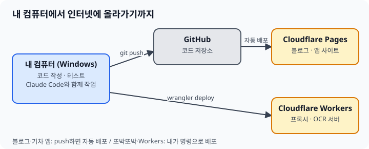
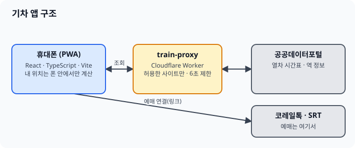
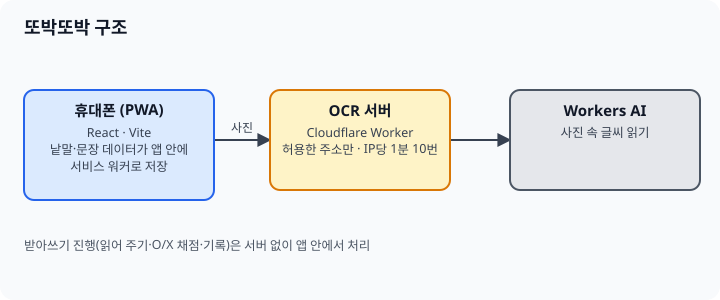
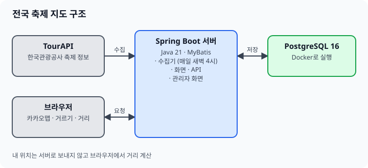

앱이 여러 개가 되니 "이건 어디서 돌고, 뭘로 만들었더라?"가 헷갈리기 시작했다. 한 번에 볼 수 있게 그림으로 정리해 둔다.

## 한눈에 보기

| 이름 | 하는 일 | 주요 기술 | 올라가는 곳 |
|---|---|---|---|
| 이 블로그 | 학습 기록 | Astro, MDX, RSS, sitemap | Cloudflare Pages |
| 기차 앱 | 가까운 역·환승 경로·예매 연결 | React, TypeScript, Vite, Playwright | Cloudflare Pages |
| train-proxy | 기차 앱이 쓰는 중간 서버 | TypeScript, Wrangler, Vitest | Cloudflare Workers |
| 또박또박 | 초등 1~3학년 받아쓰기 | React, Vite | Cloudflare Pages |
| ddobak-ocr | 사진 채점용 글씨 읽기 서버 | JavaScript, Workers AI | Cloudflare Workers |
| 축제 지도 | 전국 축제를 지도에서 찾기 | Java 21, Spring Boot 4.1, MyBatis, PostgreSQL | 만드는 중 (내 컴퓨터) |

## 내 컴퓨터에서 인터넷까지

- 코드는 Windows 컴퓨터에서 쓰고, Claude Code와 함께 작업한다.
- 코드는 GitHub에 올린다. **블로그와 기차 앱은 올리기만 하면 자동으로 배포**된다. 기차 앱은 GitHub Actions가 빌드해서 Cloudflare Pages에 올려 준다.
- 또박또박과 Workers(프록시·OCR 서버)는 내가 명령(`deploy.cmd`, `wrangler deploy`)을 실행해서 올린다.
- 인증키 같은 비밀 값은 코드에 넣지 않고 환경변수나 별도 설정에만 둔다.

## 기차 앱

- 앱은 휴대폰에 설치할 수 있는 웹앱(PWA)이다.
- 열차 정보는 앱이 공공데이터포털을 직접 부르지 않고 **train-proxy를 거쳐** 받는다. 인증키를 앱에 넣지 않으려는 것이고, 프록시는 허용한 사이트에서 온 요청만 받는다.
- 내 위치는 휴대폰 안에서만 계산하고 서버로 보내지 않는다.
- 예매는 앱에서 하지 않고, 코레일톡·SRT로 연결해 준다.
- 테스트는 Playwright로 16개를 돌린다.

## 또박또박

- 낱말과 문장은 앱 안에 데이터(JSON)로 들어 있어서, 문제를 읽어 주고 O/X로 채점하고 기록하는 건 서버 없이 앱 안에서 된다.
- 서버가 필요한 건 **사진으로 채점하는 기능**뿐이다. OCR 서버가 Cloudflare의 Workers AI로 사진 속 글씨를 읽는다.
- OCR 서버는 허용한 주소의 요청만 받고, 한 사람(IP)이 1분에 10번까지만 쓸 수 있게 막아 뒀다. 무료 사용량을 남이 다 쓰지 못하게 하려는 것이다.

## 전국 축제 지도

- 앞의 앱들과 달리 **서버가 있는 구조**다. Spring Boot 서버가 화면과 API, 관리자 화면을 모두 맡는다.
- 수집기가 매일 새벽 4시에 TourAPI에서 축제 정보를 받아 PostgreSQL에 저장한다. DB는 Docker로 띄운다.
- 날짜·테마 거르기와 내 주변 거리 계산은 서버가 아니라 브라우저에서 한다. 내 위치를 서버로 보내지 않으려는 이유도 있다.
- 아직 만드는 중이라 내 컴퓨터에서만 돌린다.

## 쓰는 도구

- **편집·실행**: Claude Code, IntelliJ IDEA(Java), 터미널
- **저장·배포**: Git, GitHub(Actions 포함), Cloudflare(Pages, Workers, Wrangler)
- **웹**: Node.js, React, Vite, Astro
- **서버·DB**: Java 21, Spring Boot, MyBatis, PostgreSQL, Docker Desktop, DBeaver
- **테스트**: Playwright, Vitest

## 정리하면서 느낀 것

- 앱이 직접 인증키를 들고 있지 않게, 사이에 작은 서버(Worker)를 하나 두는 구조를 기차 앱과 또박또박에 똑같이 썼다.
- 서버가 꼭 필요한 부분만 서버에 두면 관리할 게 줄어든다. 또박또박은 사진 채점만 서버를 쓴다.
- 위치 같은 개인 정보는 기차 앱과 축제 지도 모두 서버로 보내지 않는 쪽으로 만들었다.
