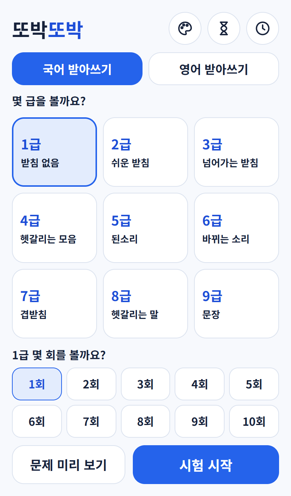
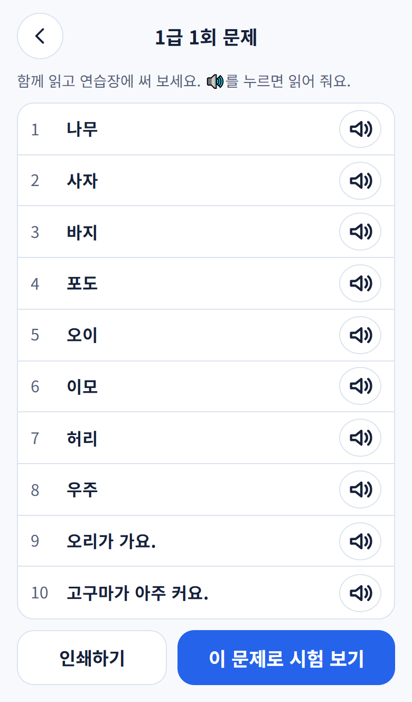
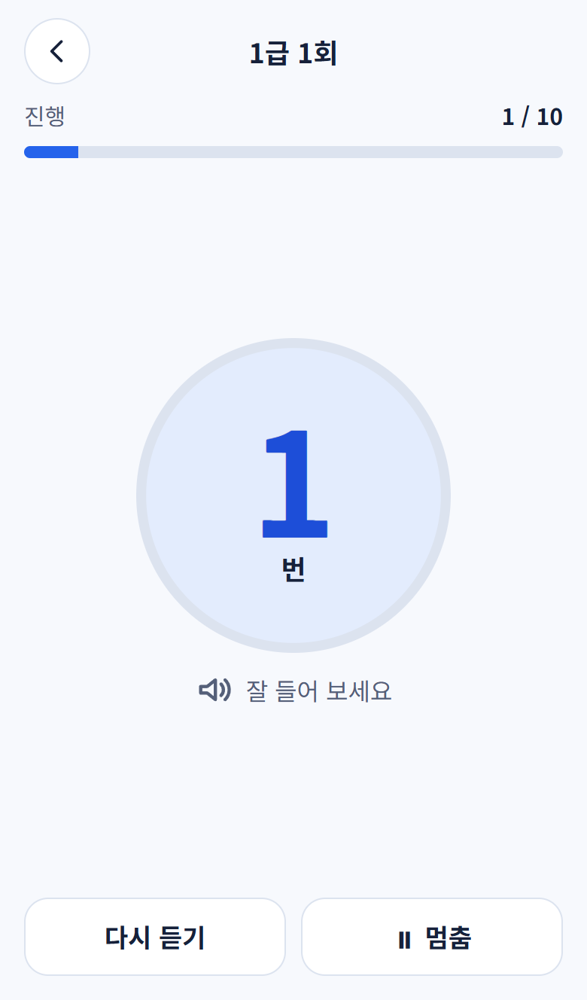
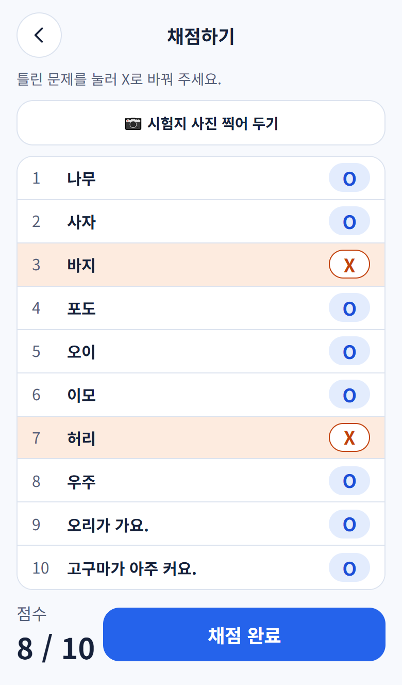
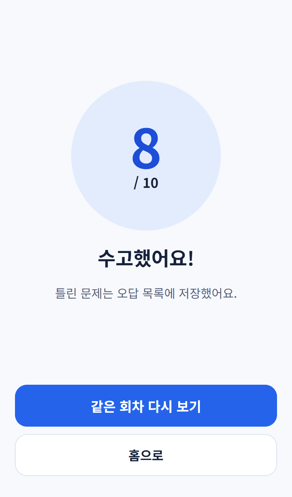
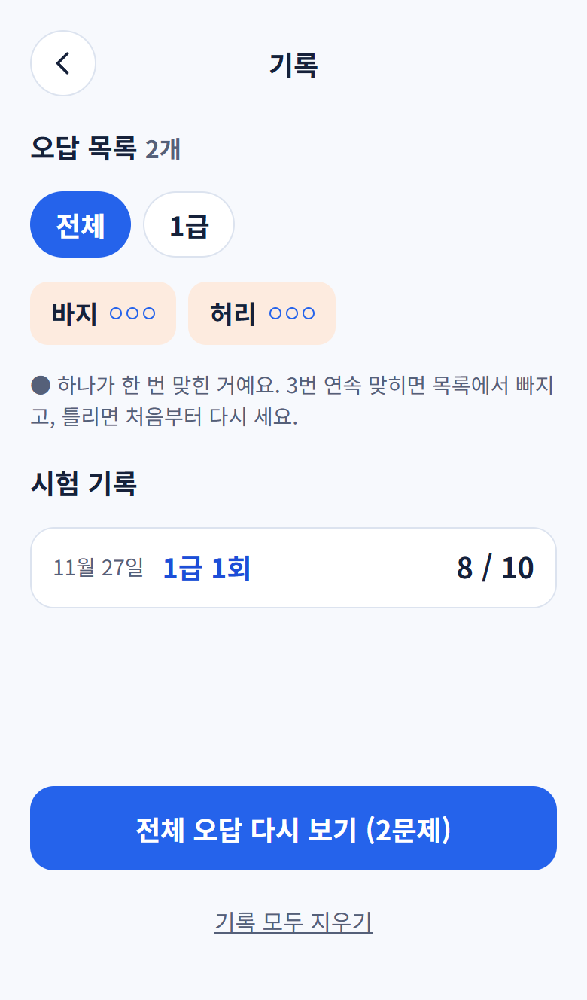
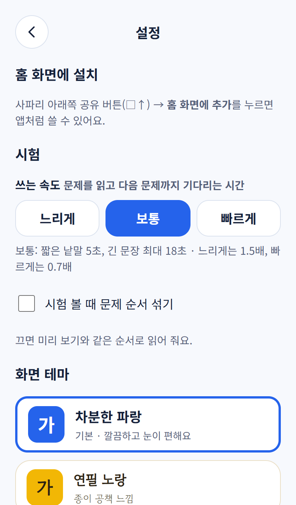

초등학교 1~3학년 아이와 **집에서 받아쓰기 연습**을 할 때 쓰는 앱이에요. 앱이 문제를 또박또박 읽어 주면 아이는 종이에 받아 쓰고, 어른은 정답을 보며 O/X만 누르면 돼요. 틀린 문제는 따로 모아 다시 연습할 수 있어요.

👉 앱 열기: [ddobak.pages.dev](https://ddobak.pages.dev)

**준비물**: 휴대폰(소리 켜기), 아이가 쓸 종이와 연필

## 1. 급수와 회차 고르기

**국어 받아쓰기** 또는 **영어 받아쓰기**를 고르고, 급수(1급 받침 없음 ~ 9급 문장)와 회차(1~10회)를 누르세요. 한 회차는 10문제예요.

## 2. 문제 미리 보기 (연습)

시험 전에 연습하고 싶다면 **문제 미리 보기**를 누르세요. 이번 회차 문제가 모두 나오고, 🔊를 누르면 하나씩 읽어 줘요. **인쇄하기**로 종이에 뽑을 수도 있어요.

## 3. 시험 보기

**시험 시작** → **▶ 시작**을 누르면 앱이 "1번. 나무"처럼 문제를 두 번씩 읽어 줘요. 아이가 쓸 시간을 기다렸다가 다음 문제로 저절로 넘어가요. 못 들었으면 **다시 듣기**, 잠깐 쉬려면 **멈춤**을 누르세요.

## 4. 채점하기 (어른이 해 주세요)

10문제가 끝나면 **채점하기**를 누르세요. 정답이 나오니 아이 종이와 비교해서 **틀린 문제만 눌러 X로 바꾸고** **채점 완료**를 누르면 돼요. 시험지를 사진으로 남겨 두고 싶다면 **📷 시험지 사진 찍어 두기**를 누르세요.

## 5. 점수 확인

점수가 나오고, 틀린 문제는 **오답 목록**에 저절로 저장돼요. **같은 회차 다시 보기**로 바로 다시 도전할 수도 있어요.

## 6. 기록과 오답 다시 보기

첫 화면 오른쪽 위 **기록** 버튼을 누르면 지금까지 본 시험 점수와 오답 목록이 나와요. **전체 오답 다시 보기**로 틀렸던 문제만 모아 다시 시험을 볼 수 있어요. 같은 문제를 3번 연속 맞히면 오답 목록에서 빠져요.

> 기록은 이 휴대폰에만 저장돼요. 다른 기기에서는 따로 쌓여요.

## 7. 설정: 읽는 속도와 화면 색

첫 화면 오른쪽 위 **설정** 버튼에서 바꿀 수 있어요.

- **시험 속도**: 아이가 쓰는 게 느리면 **느리게**를 골라 주세요.
- **문제 순서 섞기**: 미리 보기와 다른 순서로 시험을 봐요.
- **화면 테마**: 파랑, 노랑, 초록, 주황, 밤하늘 중에서 골라요.
- **목소리**: 읽어 주는 목소리와 빠르기를 바꾸고 미리 들어 볼 수 있어요.

## 휴대폰 홈 화면에 추가하기

앱처럼 아이콘을 눌러 바로 열고 싶다면 홈 화면에 추가해 두세요.

- **아이폰 (Safari)**: 아래쪽 공유 버튼(□↑) → **홈 화면에 추가**
- **안드로이드 (Chrome)**: 오른쪽 위 ⋮ 메뉴 → **홈 화면에 추가** 또는 **앱 설치**
