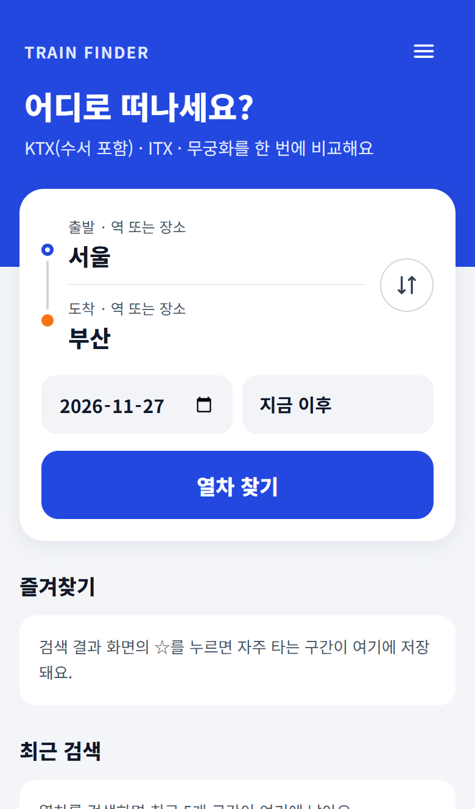
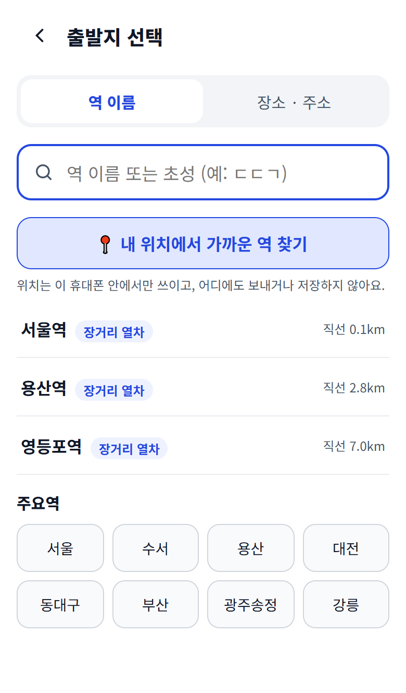
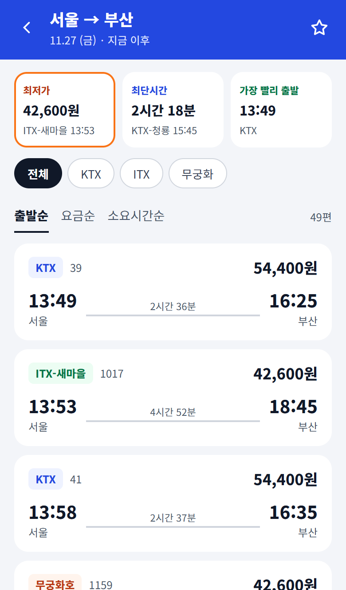
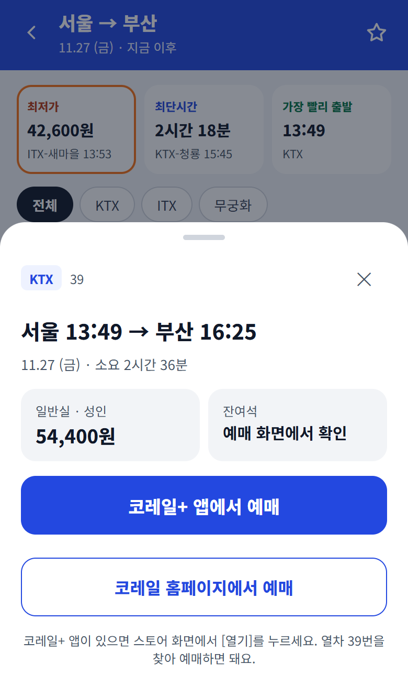
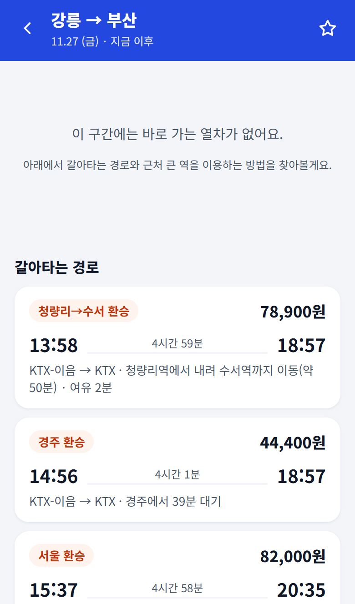
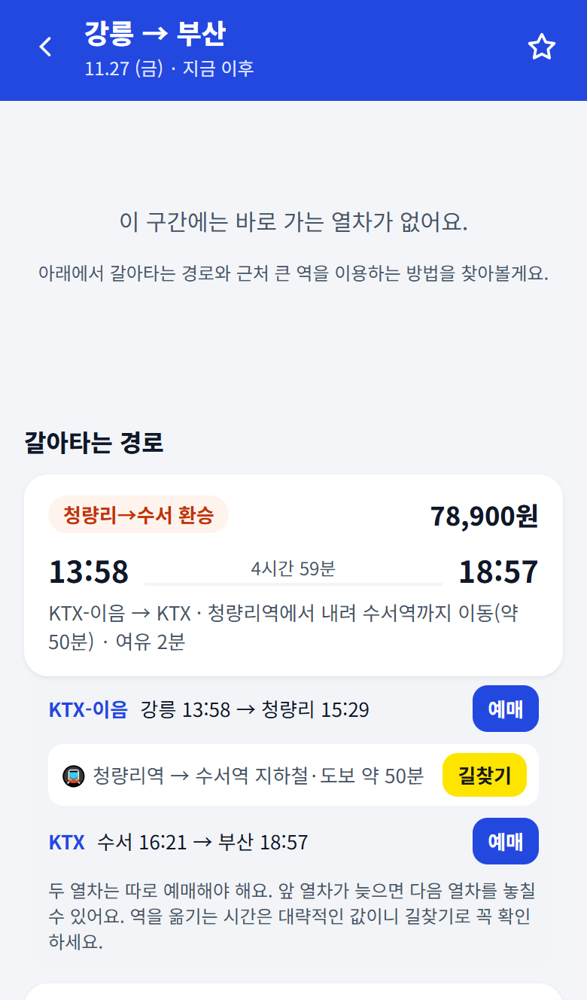

기차를 타야 하는데 **어느 역에서, 몇 시 열차를, 얼마에** 탈 수 있는지 한눈에 보고 싶을 때 쓰는 앱이에요. KTX(수서 포함), ITX, 무궁화를 한 화면에서 비교하고, 바로 가는 열차가 없으면 갈아타는 방법도 찾아 줘요.

👉 앱 열기: [gicha.pages.dev](https://gicha.pages.dev)

설치하지 않아도 휴대폰 인터넷 창에서 바로 쓸 수 있어요.

## 1. 출발지와 도착지 고르기

첫 화면에서 **출발**과 **도착**을 눌러 역을 고르고, 날짜와 시간을 정한 뒤 **열차 찾기**를 누르세요. 가운데 ⇅ 버튼을 누르면 출발과 도착이 바뀌어요.

## 2. 내 주변 역 찾기

어느 역이 가까운지 모르겠다면 출발지 화면에서 **📍 내 위치에서 가까운 역 찾기**를 누르세요. 가까운 역이 거리 순서로 나와요. 역 이름을 직접 쳐도 되고, 초성만 써도 찾아져요(예: `ㄷㄷㄱ` → 동대구).

> 내 위치는 휴대폰 안에서만 쓰고, 어디에도 보내거나 저장하지 않아요.

## 3. 열차 비교하기

검색 결과 맨 위에 **최저가**, **최단시간**, **가장 빨리 출발**하는 열차가 정리돼 있어요. 그 아래에서 KTX, ITX, 무궁화만 골라 보거나, 요금순이나 소요시간순으로 다시 정렬할 수 있어요. 오른쪽 위 ☆를 누르면 자주 타는 구간이 첫 화면에 저장돼요.

## 4. 예매하러 가기

마음에 드는 열차를 누르면 요금과 시간이 나와요. **코레일+ 앱에서 예매** 또는 **코레일 홈페이지에서 예매**를 누르면 예매 화면으로 넘어가요. 남은 좌석은 예매 화면에서 확인할 수 있어요.

## 5. 바로 가는 열차가 없을 때

강릉에서 부산처럼 한 번에 가는 열차가 없으면 **갈아타는 경로**를 대신 보여 줘요. 어디서 갈아타는지, 얼마나 기다리는지가 함께 나와요.

경로를 누르면 열차마다 **예매** 버튼이 있고, 다른 역으로 옮겨 타야 할 때는 **길찾기** 버튼으로 가는 길을 볼 수 있어요. 열차는 각각 따로 예매해야 해요.

## 휴대폰 홈 화면에 추가하기

앱처럼 아이콘을 눌러 바로 열고 싶다면 홈 화면에 추가해 두세요.

- **아이폰 (Safari)**: 아래쪽 공유 버튼(□↑) → **홈 화면에 추가**
- **안드로이드 (Chrome)**: 오른쪽 위 ⋮ 메뉴 → **홈 화면에 추가** 또는 **앱 설치**
