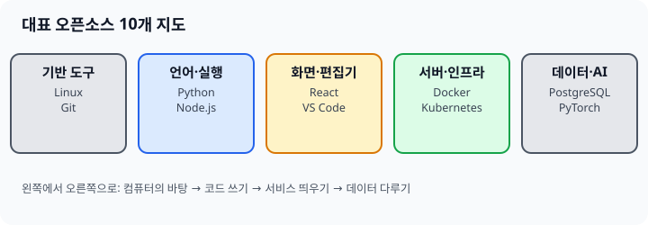

개발 공부를 하다 보면 "리눅스", "도커", "리액트" 같은 이름이 계속 나온다. 다 오픈소스라는데 정확히 뭔지 몰라서, 가장 많이 쓰이는 것부터 정리해 본다. 요즘 새로 뜨는 것들은 다음 글에서 따로 다룬다.

## 오픈소스가 뭐길래

**오픈소스**는 만든 사람이 코드를 모두에게 공개해 두고, 정해진 규칙(라이선스) 안에서 누구나 쓰고 고칠 수 있게 한 소프트웨어다. GitHub는 그 코드를 올려 두고 같이 고치는 곳이고, 마음에 들면 누르는 **별(star)** 이 인기의 표시가 된다.

그런데 별이 많다고 많이 쓰이는 건 아니다. 별 순위 맨 위쪽에는 "직접 만들어 보며 배우기", "멋진 자료 모음" 같은 **학습 자료 모음**이 올라와 있는 경우가 많다. 사람들이 저장해 두려고 누르기 때문이다. 그래서 이 글은 별 수가 아니라 **실제로 어디서나 쓰이는 것**을 기준으로 골랐다.

## 기반 도구

### 1. Linux
컴퓨터의 가장 밑바닥을 맡는 운영체제의 핵심(커널)이다. 인터넷 서버 대부분과 안드로이드 폰이 이걸 바탕으로 돈다. 1991년 리누스 토르발스가 혼자 시작했고 지금은 전 세계 개발자가 함께 만든다. 저장소: `torvalds/linux`

### 2. Git
코드의 **변경 기록을 저장하는 도구**다. "어제 상태로 되돌리기", "여럿이 같은 코드 고치기"가 가능해진다. 리누스 토르발스가 리눅스를 관리하려고 2005년에 만들었다. GitHub는 이 Git을 인터넷에 올려 쓰는 서비스다. 저장소: `git/git`

## 언어와 실행 환경

### 3. Python
읽기 쉬운 문법으로 유명한 프로그래밍 언어다. 데이터 분석과 AI 쪽에서 특히 많이 쓰인다. 저장소: `python/cpython`

### 4. Node.js
원래 웹 브라우저 안에서만 돌던 JavaScript를 **브라우저 밖에서도 실행**하게 해 주는 도구다. 웹 개발 도구 대부분이 이 위에서 돌아간다. 저장소: `nodejs/node`

## 화면과 편집기

### 5. React
웹 화면을 **작은 조각(컴포넌트)으로 나눠 만드는** 라이브러리다. Meta(페이스북)가 만들었다. 저장소: `facebook/react`

### 6. VS Code
Microsoft가 만든 코드 편집기다. 확장 프로그램을 붙여서 어떤 언어든 편하게 쓸 수 있다. 저장소: `microsoft/vscode`

## 서버와 인프라

### 7. Docker
프로그램을 **실행 환경까지 통째로 상자(컨테이너)에 담아** 어디서나 똑같이 돌리게 해 준다. "내 컴퓨터에서는 되는데요"를 줄여 준다. 오픈소스 부분의 저장소: `moby/moby`

### 8. Kubernetes
컨테이너가 수백, 수천 개가 되면 사람이 일일이 관리할 수 없다. 그 컨테이너들을 **자동으로 띄우고, 죽으면 다시 살리고, 늘리고 줄이는** 도구다. 구글에서 시작했다. 저장소: `kubernetes/kubernetes`

## 데이터와 AI

### 9. PostgreSQL
30년 넘게 이어져 온 **데이터베이스**다. 표 모양으로 데이터를 저장하고 SQL이라는 언어로 꺼낸다. 저장소: `postgres/postgres`

### 10. PyTorch
AI 모델을 만들고 학습시키는 도구다. 연구 논문과 AI 서비스에서 많이 쓴다. 저장소: `pytorch/pytorch`

## 내가 이미 쓰고 있던 것

정리하다 보니 이미 쓰는 게 꽤 있었다.

| 오픈소스 | 어디에 썼나 |
|---|---|
| Git | 모든 프로젝트의 코드 기록, GitHub에 올리기 |
| Node.js | 블로그와 앱을 만들고 실행할 때 |
| React | 기차 앱, 또박또박 |
| Docker | 축제 지도의 데이터베이스 띄우기 |
| PostgreSQL | 축제 지도의 데이터 저장 |

이름만 알던 것들이 내 프로젝트 안에 이미 들어와 있었다.

## 다음 글

요즘 GitHub에서 빠르게 뜨는 프로젝트를 따로 정리할 예정이다. 찾아보니 AI 에이전트와 개발 도구 쪽이 많았다.
