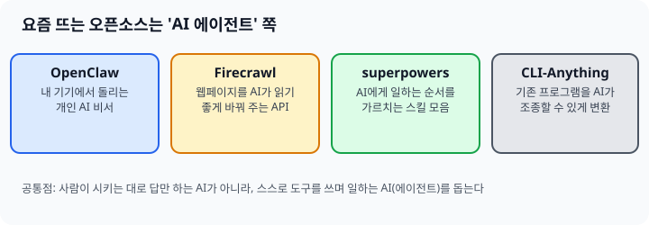

지난 글에서 오래 많이 쓰이는 대표 오픈소스를 정리했다. 이번에는 **요즘 GitHub에서 뜨는 것**을 봤다. 인기 목록을 모아 보는 사이트들을 훑어보니 AI 에이전트와 개발 도구 쪽이 눈에 많이 띄었다.

## 에이전트가 뭔데

그냥 질문에 답하는 AI와 달리, **스스로 도구를 골라 쓰면서 일을 끝까지 해 보는 AI**를 에이전트라고 한다. 파일을 열고, 웹을 읽고, 프로그램을 실행하는 식이다. 요즘 뜨는 프로젝트들은 이 에이전트를 만들거나, 더 잘 일하게 도와주는 것들이다.

## 1. OpenClaw: 내 기기에서 돌리는 개인 AI 비서

- 내 컴퓨터나 기기에서 직접 돌리는 **개인 AI 비서**다. 카카오톡처럼 이미 쓰는 메신저(WhatsApp, Telegram, Slack, Discord 등)로 말을 걸 수 있다.
- 중앙의 게이트웨이가 여러 채널과 도구를 이어 주는 구조다. MIT 라이선스다.
- 올해 초 별을 가장 빨리 모은 프로젝트로 여러 곳에서 소개됐다.
- 안내 문서에도 나오는 주의점이 있다. 모르는 사람이 보낸 메시지는 **믿으면 안 되는 입력**으로 다뤄야 하고, 기본값은 허락한 사람만 받게 돼 있다. 내 컴퓨터에서 일을 시키는 도구라서 보안이 중요하다.

## 2. Firecrawl: 웹을 AI가 읽기 좋게

- 웹페이지를 AI가 읽기 좋은 깔끔한 글(마크다운)이나 구조화된 데이터로 바꿔 주는 API다.
- 페이지 긁어오기, 검색, 사이트 지도 만들기 같은 기능이 있고, 버튼을 누르거나 입력창을 채우며 페이지를 조작하는 기능도 있다.
- Claude, Cursor 같은 도구가 쓸 수 있게 MCP 서버도 제공한다.
- 직접 설치해서 쓸 수도 있고, 회사가 운영하는 서비스를 쓸 수도 있다.

## 3. superpowers: AI에게 일하는 순서를 가르치기

- Claude Code 같은 코딩 AI에게 **"먼저 계획을 세우고, 테스트부터 쓰고, 끝나면 확인하라"** 같은 일하는 방법을 스킬로 가르치는 모음이다.
- 만든 사람은 Jesse Vincent(GitHub 아이디 obra)다. MIT 라이선스다.
- 설치하면 작업을 시작할 때 AI가 알아서 알맞은 스킬을 찾아 쓴다.
- 이름이 같은 포크가 아주 많아서, 설치할 때 주소가 `github.com/obra/...`인지 꼭 확인해야 한다.

## 4. CLI-Anything: 기존 프로그램을 AI가 조종하게

- 마우스로 누르는 프로그램을 AI가 쓸 수 있도록, **명령어(CLI) 형태로 바꿔 주는** 프로젝트다. 슬로건은 "모든 소프트웨어를 에이전트가 쓸 수 있게"다.
- 새로 기능을 다시 만드는 게 아니라 실제 프로그램의 API나 스크립트 기능을 불러서 움직인다.
- 만들어 둔 것을 모아 둔 목록(CLI-Hub)에서 골라 설치할 수 있다.

## 뜨는 걸 쓰기 전에 확인할 것

- **진짜 저장소인가**: 같은 이름의 복사본(포크)이 많다. 만든 사람 이름을 확인한다.
- **라이선스**: 내 프로젝트에 써도 되는지 확인한다. 문서와 파일의 라이선스가 서로 다르게 적힌 경우도 있었다.
- **권한**: 내 컴퓨터와 계정에서 일하는 도구는 무엇을 허용할지 꼭 정한다.
- **별 수는 참고만**: 같은 프로젝트라도 소개글마다 별 수가 달랐다. 정확한 숫자는 GitHub에서 직접 본다.

## 정리

지난 글의 Linux, Git, React는 몇십 년 쓰이는 **바탕**이라면, 이번 글의 프로젝트들은 AI가 일하는 방식이 바뀌면서 **지금 빠르게 생기는 것들**이다. 순위는 매일 바뀌니, 이 글은 2026년 11월 말의 한 장면으로 남겨 둔다.
